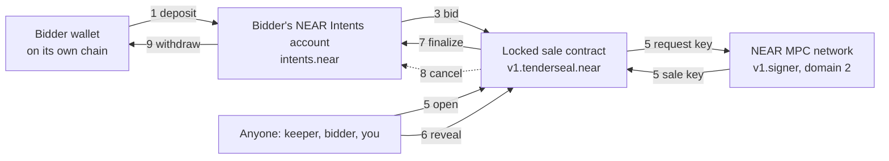

# Tender: sealed-bid token sales from any chain, opened by NEAR's MPC network

Problem: in most of the token sales we compared ([below](#how-it-compares)) every bid is public, so participants snipe and herd, and buyers on other chains must bridge first.

Tender keeps each bid's price and size encrypted until the sale's key is released. A bid from Base, Arbitrum, Solana or NEAR is one signed NEAR Intents transfer that carries the ciphertext and escrows USDC. After close, the locked sale contract asks NEAR's MPC network for the sale's key only if the sale's public open conditions hold (total escrow ≥ `min_escrow`, bidders ≥ `min_bidders`). Then anyone can decrypt every bid, and the sale clears at one price anyone can recompute. Otherwise anyone can cancel the sale for full refunds, and its key is never requested.

**Status, 2026-11-11 UTC.** Runs today: steps 1-9 below ([`git clone` once the repo is public](JUDGES.md#off-chain)) and [a full testnet sale with a real MPC key](JUDGES.md#testnet). Not live yet: the mainnet contract `v1.tenderseal.near`, the [hosted app and demo video](JUDGES.md#off-chain). Every claim and its proof: [JUDGES.md](JUDGES.md).

## Try it (free, no wallet)

Use Node 24.22.2 (`.nvmrc`); without corepack, use `npx -y pnpm@12.18.0` wherever a step says `pnpm`. Step 8 needs rustup (`contract/rust-toolchain.toml` installs Rust 1.99.1) and `cargo install --locked cargo-near@0.23.0`.

Node 18 or 20

Node 18 does not work, nor Node 20: the install stops with `ERR_PNPM_UNSUPPORTED_ENGINE` and names the Node it needs. With corepack on Node 18 and an empty corepack cache, the error is `Cannot find module '…/pnpm/12.18.0/bin/pnpm.cjs'` instead.

1. (network: GitHub, npm) `git clone https://github.com/kocality/tender && cd tender && corepack enable && pnpm install --filter "@tender/cli..."` - see `Scope: 4 of 7 workspace projects` and `Packages: +46`: the CLI and its libraries, no wallet SDKs.
2. (offline) `pnpm demo:local` - see `P* = 3.60 USDC/NEAR · 6/6 bids decrypted · commitments 6/6` and `done in` under a second: the [worked example](#how-it-works), sealed, opened and cleared on your machine. If you run only one step, run this one.
3. (offline) `pnpm vectors` - see `4 passed (4)`: the near/mpc CKD test vectors.
4. (offline) `node contract/scripts/check-imports.mjs contract/res/tender.wasm` - see `PASS 24 imports`: none can add a key, deploy code or delete the account.
5. (network: testnet RPC) `curl -s https://rpc.testnet.near.org -H 'content-type: application/json' -d '{"jsonrpc":"2.0","id":1,"method":"query","params":{"request_type":"view_account","finality":"final","account_id":"rc2.tender-339e4b.testnet"}}'`, then the same with `"request_type":"view_access_key_list"` - see `"code_hash":"7Wr8DDsDA9XYJMw48HwDg4Y5vbWLwd38EN2A9trAezDv"` (the base58 form of step 9's sha256) and `"keys":[]`.
6. (network: testnet RPC) `pnpm verify --network testnet --contract rc2.tender-339e4b.testnet --keys` - see `key log (contract state): 0 requests` and `= 0 (match)`.
7. (network on a fresh machine) `pnpm install && pnpm -r test`, now for the whole workspace - see every package pass with the counts in the [Tests row](#build-and-test-evidence).
8. (Rust; downloads near-sandbox) `bash contract/scripts/build-wasms.sh && (cd contract && cargo test)` - see the unit, sandbox and S3a tests pass with the counts in the Tests row.
9. (Docker, about 3 min plus a one-time image pull, full git history) `git checkout 8812fce143290ba83a2597acc60e49e161a20383 && (cd contract && cargo near build reproducible-wasm && shasum -a 256 target/near/tender.wasm)` - see `60cb8293f4d48883d693cae051ed14d04cb8686669ab9477def8d110c412b2a9`, the value in `contract/res/tender.wasm.sha256`. Build exactly this commit: the NEP-330 metadata embeds the commit, so any later commit gives a different hash. On arm64 Macs, Docker's linux/amd64 platform warning is expected.

Steps 10-18: on chain, once the rows they need exist

Step 10 needs testnet rows T4-T9; steps 11-15 need the mainnet rows of their sale ([Demo sales](#demo-sales)); 16-18 also need the hosted app. Until then, step 10 prints `sale 0 not found` and steps 11-15 stop with `UNKNOWN_ACCOUNT`.

| # | Do | See |
|---|---|---|
| 10 | `pnpm verify --network testnet --contract rc2.tender-339e4b.testnet --sale 0` | no `FAIL` line; `#3 code-hash` PASS against the RC2 wasm |
| 11 | `pnpm verify --keys` | every key `v1.tenderseal.near` ever requested, one line per sale |
| 12 | `pnpm seal:try --sale 2` | before `2026-11-17T12:00:00Z`: `sealed: no key has been requested for sale 2 (key_requests = 0)`; after close: `key released at block …` |
| 13 | `pnpm verify --sale 1` | no `FAIL` line; `#15 clearing-price` `P* = 3.60 USDC/NEAR` |
| 14 | `pnpm verify --sale 0` | `#23 cancelled-sealed` PASS: `Cancelled · 0 key requests · never requested (sealed unless the MPC threshold colludes)` |
| 15 | `pnpm verify --sale 3` | garbage and copied bids `Penalized`; `#17 conservation` PASS |
| 16 | hosted app `#/try`: sign with MetaMask, Phantom or a NEAR wallet | `signature valid · insufficient balance` (a view call; nothing is spent) |
| 17 | hosted app `#/`: press **Decrypt** on sale 1 (sales 1 and 0 side by side) | 6 bids decrypt in your browser and match their on-chain commitments |
| 18 | optional, costs at least 1 USDC: bid on sale 2 at hosted app `#/bid/2` before close | the bid is stored sealed |

Every check and flag: [docs/verify.md](docs/verify.md).

## How it works

Edge numbers are the table rows.

| # | What happens | Funds sit in |
|---|---|---|
| 1 | **Deposit.** USDC goes into the bidder's own Intents account, directly or through a 1Click deposit address. The app has no send code: you send from your own wallet. | the bidder's Intents account |
| 2 | **Seal.** In the browser or the CLI: Boneh-Franklin IBE to `pk ‖ app_id(v1.tenderseal.near, path)`, bound by a sha256 commitment. | unchanged |
| 3 | **Bid.** Signed with erc191, raw_ed25519 or nep413; carries the commitment too. | the contract's Intents account |
| 4 | **Store or refund.** `mt_on_transfer` stores the bid or [refunds it](docs/protocol.md#bids-the-contract-refunds). | the contract, or back to the bidder |
| 5 | **Open.** After close anyone can call `open`; the contract records `key_requests += 1` before the MPC call. | the contract |
| 6 | **Reveal.** Anyone can call `reveal` with the decrypted bids; our keeper does this. Bidders can also [self-reveal](docs/protocol.md#reveal). | the contract |
| 7 | **Finalize.** Integer-only clearing, paid out with `mt_batch_transfer`. An unrevealed bid can lose 10% of its escrow. | the bidders' and seller's Intents accounts ([penalty pool](docs/protocol.md#clearing-and-penalty)) |
| 8 | **Cancel.** `cancel` ([rule](docs/protocol.md#sale-states)). | back in the bidders' Intents accounts |
| 9 | **Withdraw.** Back to an origin chain through a 1Click quote; recorded: [S5](JUDGES.md#mainnet-spikes-before-the-contract). | the bidder's wallet |

Worked example (sale 1, from `fixtures/clearing/demo-sale-1.json`). A bid's size is the USDC it spends if it wins in full; its escrow `B` is at least that, and whatever it does not spend is refunded. The sale sells 3 NEAR with a reserve of 3.00 USDC per NEAR. Six sealed bids offer 4, 3, 3, 2, 3 and 2 USDC at 3.90, 3.80, 3.70, 3.60, 3.20 and 2.90 USDC per NEAR. The price is the highest one at which the bids at or above it buy all 3 NEAR: at 3.70 their 10 USDC buy about 2.7 NEAR, at 3.60 their 12 USDC buy about 3.3, so every winner pays 3.60. The 3.60 bid gets the remaining 0.22 NEAR for 0.800001 USDC, and the 3.20 and 2.90 bids lose.

### NEAR technologies used

| Technology | What Tender uses | Code |
|---|---|---|
| MPC Confidential Key Derivation | `v1.signer` 3.18.0 on 2026-11-10, domain 2 (BLS12-381), `request_app_private_key` in `identity` mode ([call](docs/protocol.md#key-request)) | `contract/src/seal.rs` |
| NEAR Intents (`intents.near` 0.4.5) | `Transfer` with notification → `mt_on_transfer` (NEP-245), `simulate_intents` / `execute_intents`, `mt_batch_transfer` | `contract/src/intents.rs`, `packages/intents` |
| 1Click API | deposit addresses and withdraw quotes | `app/src/lib/oneclick.ts` |
| NEP-141 tokens | wNEAR `wrap.near`, NEAR-native USDC, JAMBO `jambo-1679.meme-cooking.near` | `sales/` |
| NEAR Connect | `@hot-labs/near-connect` 0.12.0 for NEAR wallets | `app/` |
| Contract toolchain | near-sdk 5.30.1; cargo-near reproducible build (step 9) | `contract/Cargo.toml` |

## How it compares

| | Bids hidden before close | What opens them | Who decides to open | Bid from | Source |
|---|---|---|---|---|---|
| **Tender** | yes | NEAR MPC CKD key, requested by the sale contract | the sale contract, on its open conditions | the four chains above | this repo |
| Dark Vault | yes | a drand time lock | nobody (a time, not a condition) | Zcash; SOL through NEAR Intents | [quotes](docs/compare.md#dark-vault) |
| Uniswap CCA | no | — | — | EVM chains | [quotes](docs/compare.md#uniswap-cca) |
| Echo / Sonar | no | — | — | the sale contract's chain | [quotes](docs/compare.md#echo--sonar) |
| Shutter API | yes | a time or an on-chain event | the Keyper network | Gnosis Chain | [quotes](docs/compare.md#shutter-api) |
| MACI | yes, except from the coordinator | the coordinator | the coordinator | Ethereum (voting, not a sale) | [quotes](docs/compare.md#maci) |

Plain commit-reveal needs every bidder to come back, and a bidder who sees the other reveals can withhold their own; here the key, not the bidder, opens each bid, except one sealed as garbage ([Limits](#trust-and-limits)). What we found nowhere else is the combination: the chain's existing MPC network as the key holder, a locked contract as the only requester ([proof](JUDGES.md#claims-and-where-to-check-them)), an on-chain record of every key it got, and escrow plus settlement in the same contract. Morrowseal, in this hackathon, also releases a key from a NEAR contract on a condition; its key holder is an OutLayer TEE and its key stays private ([quote](docs/compare.md#morrowseal)). Tender requests with a public app key, so the released key is public; on 2026-11-10 no other `v1.signer` CKD caller's latest request did ([docs/ckd-callers.md](docs/ckd-callers.md)).

## Trust and limits

Privacy rests on NEAR's MPC threshold (11 of 16 nodes on 2026-11-10; `pnpm verify` prints the live value). We add no TEE and no committee of our own; the MPC nodes additionally run in attested TEEs. Resharing does not revoke old shares, so the threshold counts every party that holds or ever held a share of the domain-2 key. The salt is sealed too. Public from the start: each bid's escrow cap `B`, the bidder's Intents account, the time, total escrow, the bidder count and the origin-chain deposit transactions; the origin badge is self-declared. After release everything is public.

| You rely on | For | If it breaks |
|---|---|---|
| The MPC threshold above | bids unreadable before release | bids are read early, and nothing on chain shows it; escrow stays in the contract |
| `app_id` is derived from the calling account. `v1.tenderseal.near` is created keyless, with no upgrade method. Every sale path carries a random seed generated after the contract existed. | the only-requester rule ([above](#how-it-compares)) | someone else could request it and read the bids early |
| Contract `open` and the reproducible build | the [open-conditions rule](JUDGES.md#claims-and-where-to-check-them) | a sale could be decrypted without meeting its conditions |
| NEAR MPC liveness | the key arrives | the sale can be cancelled (row 8 above) |
| Someone revealing within the window | bids get revealed | an unrevealed bid can pay the [row 7 penalty](#how-it-works) |
| `intents.near` signature checks | bidder identity and amounts | bids or transfers could be forged |
| 1Click and its bridges | cross-chain in and out | a stuck swap follows 1Click's own refund flow, outside the contract; fees: [recorded](docs/protocol.md#off-chain-services) |
| Our hosted JavaScript bundle | encryption in your browser | a malicious bundle could leak your price before sealing; seal locally with `pnpm seal:bid` |
| Nobody: `execute_intents` is permissionless | relaying | if our relayer refuses you, relay elsewhere ([what our relayer keeps](docs/protocol.md#off-chain-services)) |

Limits (mechanics: [docs/protocol.md](docs/protocol.md)):
- **Open conditions are not prices.** Anyone with capital can push a weak sale over its thresholds with below-reserve bids, get refunded, and make every bid decrypt. `min_bidders` counts distinct Intents accounts, which are cheap to create, so it gives no Sybil resistance.
- **No decrypt check on chain.** `reveal` checks the commitment, not that the ciphertext decrypts. A bidder who seals garbage under a valid commitment gets a last look: once the other bids open, they reveal from their own bid file or withhold, at the cost of the [row 7 penalty](#how-it-works); the escrow is the bond.
- **No receipt-freeness:** the salt lets a bidder prove a bid to a briber, unlike MACI.
- **"Never requested" is not "sealed for good".** It means the contract never asked for the key. The ciphertexts stay on chain, so the MPC-threshold row above still covers them, cancelled sales included, and a future compromise of NEAR's domain-2 master key would decrypt every stored bid. [A sale cancelled after a request](docs/protocol.md#key-request) is an exception.
- **MPC key change** before a sale opens: [what then](docs/protocol.md#key-request).
- **Refunded bids stay readable.** A refunded bid is not stored, but its ciphertext stays in public transaction history and decrypts if that sale's key is released. Our CLI and app [narrow this](docs/protocol.md#bids-the-contract-refunds); other signers are not covered.
- **Shill bids.** A seller's shill bids cannot be prevented, only seen after release; use the reserve price.
- **Bid limits.** At most 64 bids per sale, 1 USDC minimum each, so refunded below-reserve bids can crowd a sale out.
- **Price ceiling.** A token with 9 or fewer decimals has a [price ceiling](docs/protocol.md#clearing-and-penalty); wNEAR (24 decimals) and JAMBO (18) have none in practice.
- **Deployment.** No audit; [sale creation is restricted](docs/protocol.md#sale-states).

## Demo sales

Team-funded demo sales: there is no external seller yet. Planned on mainnet:

| Sale | What it shows | Rows |
|---|---|---|
| 0 | Configured by us to fail its thresholds: its `min_escrow` (1,000,000.000001 USDC) is above the contract's per-sale escrow cap, so it can never open. | M02-M05 |
| 1 | The worked example: 6 bids from 4 chains; Decrypt in the browser (step 17). | M06-M16; testnet stand-ins: [T1, T2](JUDGES.md#testnet) |
| 2 | JAMBO, a meme.cooking token, sold in a sealed round that closes inside the judging window (step 12). | M18-M22 |
| 3 | Bad bids: garbage, copied and late (step 15). | [JUDGES.md › Attack room](JUDGES.md#attack-room) |

## Build and test evidence

| What | Result |
|---|---|
| Tests | clearing 13, intents 36, seal 37, relayer 369, app 350, cli 104 passing (pnpm; 22 more skipped); cargo 74 unit + 30 sandbox (+2 ignored) + 5 S3a (+1 ignored), with property tests; the sandbox uses a mock MPC. Clean clone at `0e5a603` (step 9's commit plus its build output), 2026-11-11 UTC |
| Wasm RC2 | the release candidate from the step 9 commit: 275,115 bytes, built twice with the same sha256 in the Docker image pinned in `contract/Cargo.toml`; report `evidence/wasm.json` |
| Entry points | integrators: `packages/seal/src/index.ts` (workspace package, not on npm); evidence file formats: `evidence/README.md` |

## Built during the hackathon (rules Q-001, Q-003)

All code in this repository was written inside the hackathon's code window, which Q-001 opens at the 2026-10-19 announcement, and there is no existing product on NEAR or any other chain (Q-002, Q-004). First commit: `17fbfc6`, 2026-11-10T00:57:39Z; later on 2026-11-10 (UTC) the history was rewritten to a single author, with commit dates kept. The IBE prototype core in `prototype/` (`ibe.mjs`, `pv.mjs`, `gen.mjs`, `t.mjs`, `vec.json`, `live.json`) is unchanged since its first commit; `s1-check.mjs`, `s2-encrypt.mjs`, `s2-decrypt.mjs`, `s7-check.mjs` and `seal-golden.mjs` were added later. Submitted state: the tag in [JUDGES row P4](JUDGES.md#off-chain).

## Libraries, prior work and AI code (Q-005)

- `@noble/curves` and `@noble/hashes` 2.4.0, `bs58` 6.0.0 (`@tender/seal`, `@tender/intents`); viem 2.57.16 and qrcode 1.5.4 (app); near-api-js 7.4.0 (relayer); `@defuse-protocol/intents-sdk` 0.95.0 (dev-only test oracle); near-workspaces 0.24.0 and proptest 1.12.0 (contract tests).
- Adapted code: drand/tlock-js IBE in `packages/seal/src/ibe.ts` and `prototype/ibe.mjs`; defdone/annon's import checker in `contract/scripts/check-imports.mjs`.
- Used unchanged: the near/mpc CKD test vectors (`fixtures/ckd_test_vectors.json`) and the near/intents wasm `contract/tests/res/defuse-0.4.5.wasm`.
- Parts of the code were written with AI coding assistants and reviewed by the team. No AI in the product, on purpose.
- Full list with licenses: `NOTICE`, `LICENSES/`.

## Other projects by team members (Q-015)

Arrow: an independent NEAR HACKATHON submission with no shared code, packages, contracts, accounts or wallets. Repository: [JUDGES row P6](JUDGES.md#off-chain).

## License

MIT (`LICENSE`).
