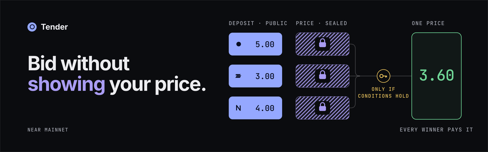
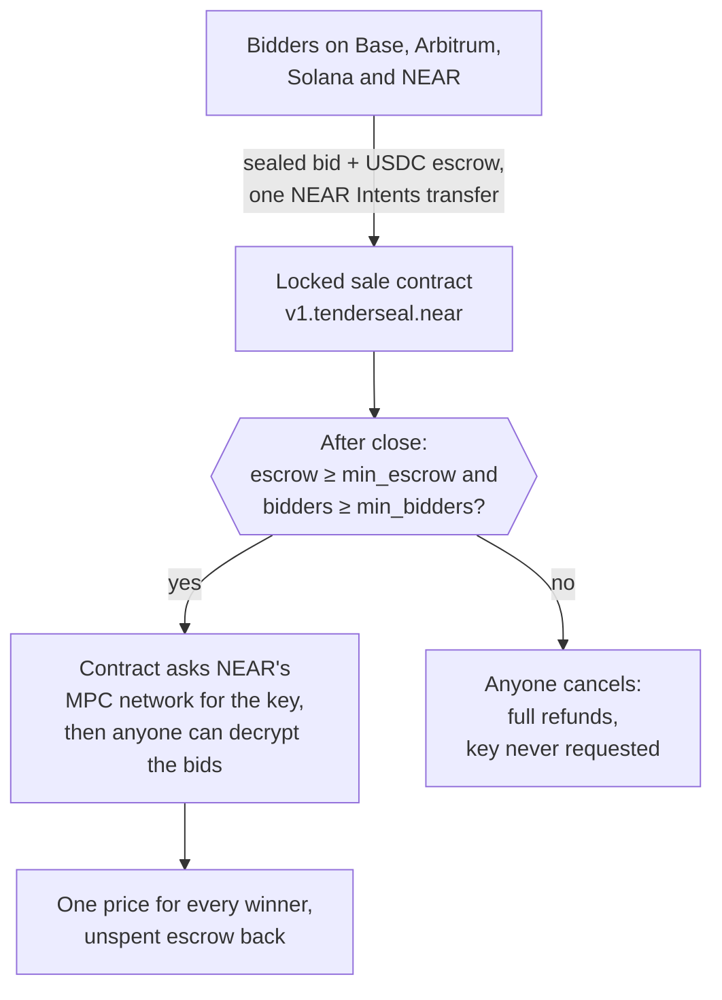
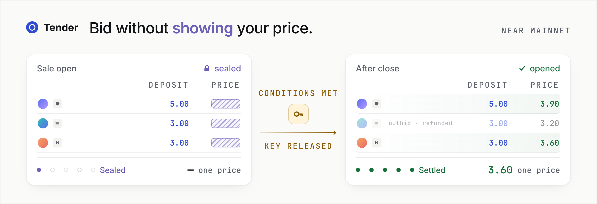
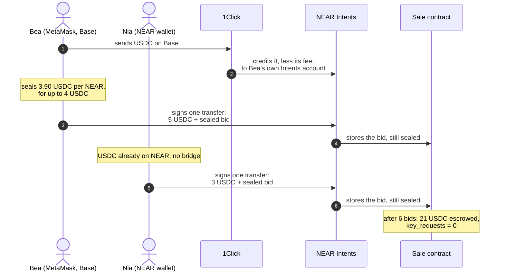
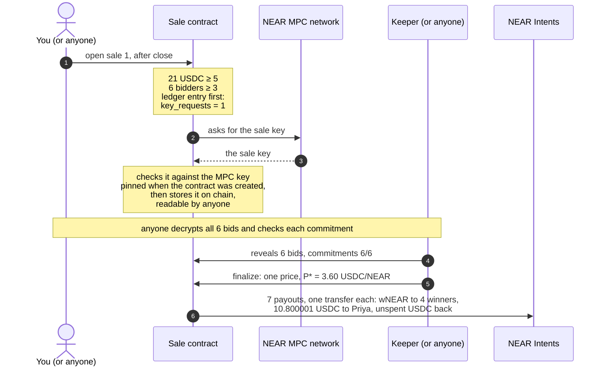
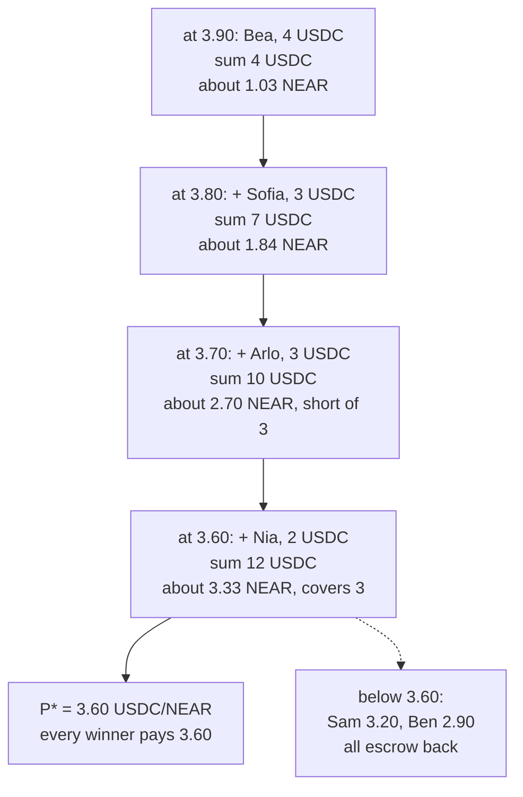
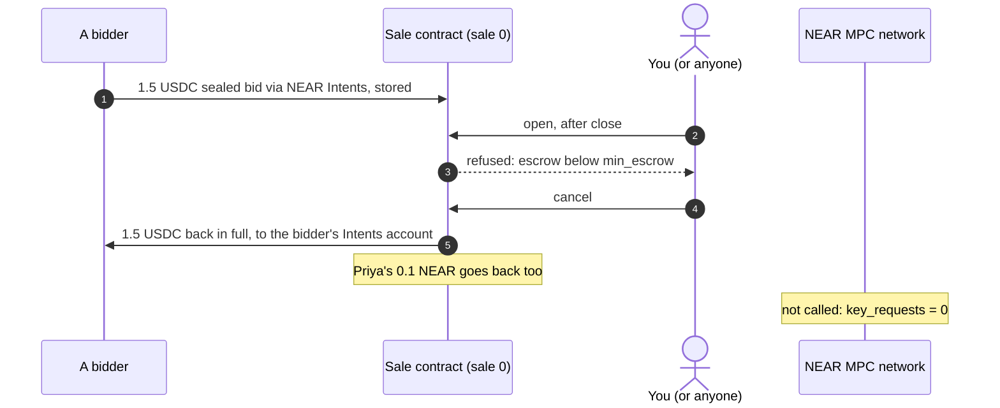
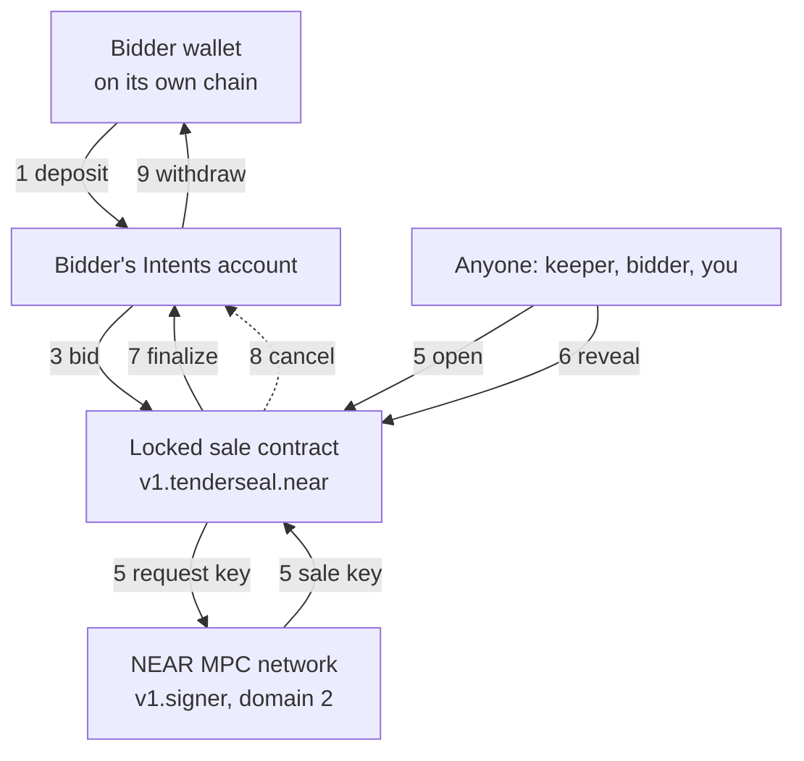
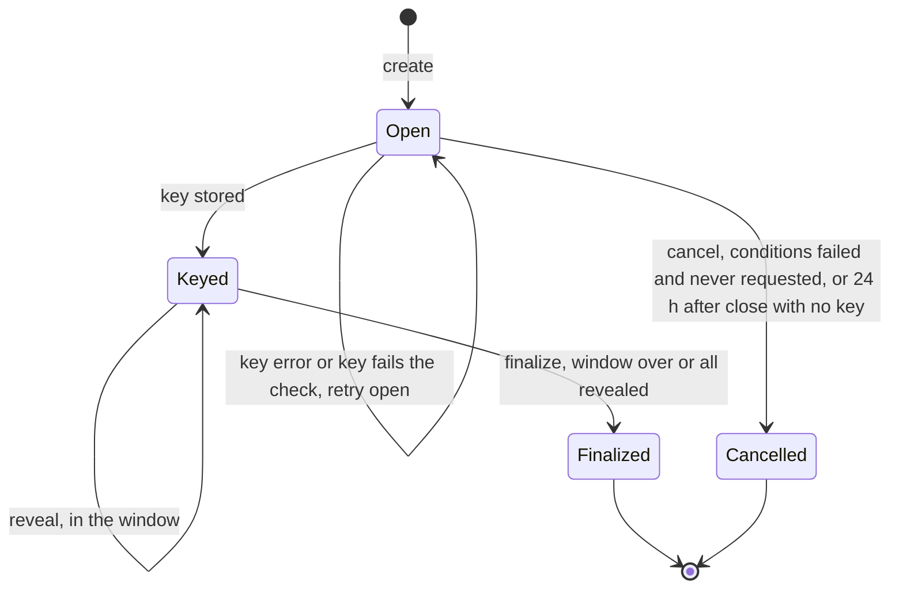
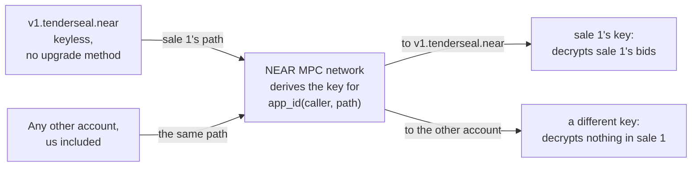

<p align="center"></p>

<p align="center">🔒 <b>Live on NEAR mainnet · keyless:</b> <code>v1.tenderseal.near</code> has 0 access keys, not even ours. <a href="https://nearblocks.io/txns/9FQuPMpJFNYJgv7dm2yyWxaUmTT73U4c9TJ9xFqMXHs3">Lock tx</a> (born keyless in one transaction, no AddKey) · verify: <code>pnpm verify --sale 1</code> → <code>25/26 checks passed (1 warning)</code></p>

<h2 align="center">Deposits public. Prices sealed. One price for every winner.</h2>

<p align="center">Tender is a <b>sealed-bid token sale on NEAR</b>. Bid in USDC from Base, Arbitrum, Solana or NEAR: other bidders and the seller see your deposit, not your price. After close, the locked sale contract asks NEAR’s MPC network for the key only if the sale’s public conditions hold; then anyone can open the bids and every winner pays the same price. Otherwise everyone is refunded and the key is never requested.</p>

<p align="center"> USDC from &nbsp; Base &nbsp; Arbitrum &nbsp; Solana &nbsp; NEAR</p>

<p align="center">
  <a href="https://github.com/kocality/tender/actions/workflows/ci.yml"></a>
  <a href="https://tender-sealed.vercel.app"></a>
  <a href="#demo-sales"></a>
  <a href="#trust-and-limits"></a>
  
  
  <a href="LICENSE"></a>
</p>

---

**Status, 2026-11-14 UTC.** Live on NEAR mainnet: the keyless contract [`v1.tenderseal.near`](https://nearblocks.io/address/v1.tenderseal.near) and the [hosted app](https://tender-sealed.vercel.app). Ran on 14 Nov: [the twin sales](#mainnet-run-14-nov), one opened by the MPC network and finalized, one cancelled with its key never requested; steps 1-13 below run today. Every claim and its proof: [JUDGES.md](JUDGES.md).

Problem: in most token sales every bid is public before close, so late bidders copy or snipe, and buyers on other chains must bridge first ([how others compare](#how-it-compares)).

Tender keeps each bid's price and size encrypted until the sale's key is released. The locked sale contract is the only account that can obtain its sales' keys from NEAR's MPC network, and it asks only when the sale's public open conditions hold.



[The story](#the-story) runs one sale down each branch.

## The story

**Priya lists a sale.** She wants to sell 3 NEAR (as wNEAR) to whoever values it most, at no less than 3.00 USDC per NEAR. She sets two public open conditions: at least 5 USDC escrowed (`min_escrow`) and at least 3 bidders (`min_bidders`). Bea, on Base, bids early; Sam, on Solana, bids later:

<p align="center"></p>

| | In a public sale | In Tender |
|---|---|---|
| What Sam sees before he bids | Bea's price, 3.90 | Bea's 5 USDC of escrow, no price |
| What Sam bids | off what he sees: he copies Bea, or bids just enough at the last block | his own value: 3.20 |

The names are illustrative and the numbers are the worked example in `fixtures/clearing/demo-sale-1.json`. This sale and its twin (below) ran on mainnet on 14 Nov with the same prices and sizes but larger escrows ([Mainnet run](#mainnet-run-14-nov)); [step 2](#try-it-free-no-wallet) replays the worked example offline.

**Six bids from four chains.** A bid's size is the USDC it spends if it wins in full; its escrow `B` is at least that, and whatever it does not spend is refunded. Each name shares its first letter with its chain:

| Bidder | Chain and wallet | Shown in step 2's output as |
|---|---|---|
| Bea | Base, MetaMask | `base · EVM-1` |
| Sofia | Solana, Phantom | `sol · SOL-1` |
| Arlo | Arbitrum, MetaMask | `arb · EVM-2` |
| Nia | NEAR, a NEAR wallet | `near · bidder.tenderseal.near` |
| Sam | Solana, Phantom | `sol · SOL-2` |
| Ben | Base, MetaMask | `base · EVM-3` |

Bea bridges a little over 5 USDC from Base into her own NEAR Intents account. Her browser seals "3.90 USDC per NEAR, for up to 4 USDC", and she signs one transfer that carries the sealed bid and 5 USDC of escrow. Nia's USDC is already on NEAR, so she skips the bridge.



**The wall at close.** This is what Sam and everyone saw grow, one row per bid (Sam's is row 4), in step 2's output:

```text
idx origin                           escrow USDC  ct (160 B)            cm
0   base · EVM-1                            5.00  gmDodKaIonkGoBVT…  f551bf5babf2…
1   sol · SOL-1                             5.00  h6b1tvKIxqIpw8m9…  5254ce0bc204…
2   arb · EVM-2                             3.00  leQ4zxpAWI/ZlOaU…  8c0894463402…
3   near · bidder.tenderseal.near           3.00  mT0zFRaxPpRINN2Z…  4cd66e955bc6…
4   sol · SOL-2                             3.00  pf0KKJnu/ALLR9Yq…  9bfe1c6463bd…
5   base · EVM-3                            2.00  gEO3MMvnpwKpYuOS…  2b7ef1873fba…
```

Your run prints other ciphertexts and commitments: the salts are random; on mainnet the rows are in the order the bids landed ([Mainnet run](#mainnet-run-14-nov)). With `key_requests = 0`, no one has requested the key. What is public and what that rests on: [Trust and limits](#trust-and-limits).

**The sale opens.** After close anyone, even you, calls `open`: 21 USDC ≥ 5 and 6 bidders ≥ 3, so the contract records the request and asks NEAR's MPC network for the sale's key.



**Every bid opens without its bidder.** The key is public now, so Sam, you or anyone can decrypt all six bids and check each against its commitment (6/6). Our keeper reveals them, so no bidder has to come back. A bid left unrevealed when the window ends can be penalized ([rule](docs/protocol.md#clearing-and-penalty)).

**One price.** Walk down from the highest price, adding up sizes, until the bids buy all 3 NEAR. Each box converts the sum to NEAR at that box's price:



Every winner pays 3.60, Bea too, though she bid 3.90; Nia, at exactly 3.60, gets what is left.

| Bidder | Sealed bid (USDC/NEAR · size USDC) | Gets NEAR | Pays USDC | Back USDC |
|---|---|---|---|---|
| Bea | 3.90 · 4 | 1.11 | 4.00 | 1.00 |
| Sofia | 3.80 · 3 | 0.83 | 3.00 | 2.00 |
| Arlo | 3.70 · 3 | 0.83 | 3.00 | 0.00 |
| Nia | 3.60 · 2 | 0.22 | 0.800001 | 2.199999 |
| Sam | 3.20 · 3 | 0 | 0.00 | 3.00 |
| Ben | 2.90 · 2, below the 3.00 reserve | 0 | 0.00 | 2.00 |

Priya receives 10.800001 USDC, and none of her 3 NEAR comes back; 10.800001 + 10.199999 = 21 USDC, the escrow that came in. Nia's extra micro-USDC is rounding: the marginal bid's payment rounds up ([rule](docs/protocol.md#clearing-and-penalty)). NEAR is rounded here; step 2 prints 24 decimals.

On mainnet the escrows were 5, 5, 4, 3, 3.5 and 2.5 USDC (an escrow above the size keeps the size private), so the refunds were 1.00, 2.00, 1.00, 2.199999, 3.50 and 2.50; P* and Priya's 10.800001 USDC are the same.

**Home again.** Each of the seven is paid into their own Intents account, and Bea takes her 1.00 USDC back to Base.

**The twin sale.** Priya also runs sale 0, set up on purpose to fail its open conditions so it shows the cancel path ([how](#demo-sales)). One bidder puts in 1.5 USDC. After close an `open` call is refused: escrow below `min_escrow`. Anyone calls `cancel`; the bid comes back in full, so does Priya's 0.1 NEAR, and the contract never calls the MPC network ([what that means](#trust-and-limits)).



On mainnet: [sale 0](#mainnet-run-14-nov). The same path in a sandbox test: `s08_min_escrow_cancel_never_requested` (step 8), with other numbers (1 NEAR for sale, `min_escrow` 50 USDC). The mechanics behind each beat: [How it works](#how-it-works), rows 1-9.

## Mainnet run, 14 Nov

The story above ran on NEAR mainnet on 2026-11-14, with the team as seller and bidders ([Demo sales](#demo-sales)). Same prices and sizes; the escrows were larger (an escrow above the size keeps the size private before close).

**The contract is born keyless.** `v1.tenderseal.near` was created in one transaction ([9FQuPMpJ…](https://nearblocks.io/txns/9FQuPMpJFNYJgv7dm2yyWxaUmTT73U4c9TJ9xFqMXHs3)) that creates the account, deploys the step 9 wasm and calls `new()`, with no `AddKey`: step 5 shows `"keys":[]` and `code_hash ArxvskvN…` today. Init block 224564596. Before it, the same wasm ran a one-bid rehearsal on `rehearsal.tenderseal.near`: its `open` got a key from `v1.signer` ([Fp3toeQp…](https://nearblocks.io/txns/Fp3toeQpoSaXUsvoUT6jhRjaSwZAWzoCRzjkaDJ5XSsJ)) and the sale was finalized ([FMYjY3Ua…](https://nearblocks.io/txns/FMYjY3UaZvkqgxs4xikmZeTCgyZqEcBdkGtUcR3yrVeH)); that account was deleted afterwards ([DEJGTvTK…](https://nearblocks.io/txns/DEJGTvTKbkDBJnk9F8nGuBZ8Pvbf8XWTk19oWYje1bHQ)).

**Priya lists the twins.** Sale 0 ([create](https://nearblocks.io/txns/6BhEYs4mPyLm7RkNuB5BY1aUcsfx8gRTK8iFvqLfsnjr): 0.1 wNEAR, `min_escrow` 1,000,000.000001 USDC, configured by us to fail its thresholds) and sale 1 ([create](https://nearblocks.io/txns/3nFEgSZY2KAgnstvE2x8Q85srspHoqoobeDzEJ6XpgBW): 3 wNEAR, reserve 3.00, `min_escrow` 5 USDC, `min_bidders` 3, `max_bids` 6), both closing 2026-11-14T22:01:00Z.

**Seven bids from six accounts on four chains.** One 1.5 USDC bid on sale 0 from Nia ([CFbtMaBf…](https://nearblocks.io/txns/CFbtMaBf8uZ8H7Nzy1ABqNDkaEMWqWiPd5VWzp47T3Zc)); six on sale 1, in the order they landed. Nia signed with her NEAR account's key (nep413); the other five signed in MetaMask or Phantom on the hosted app, and `relayer.tenderseal.near` relayed each with `execute_intents`:

| idx | Bidder | Wallet, chain | Escrow USDC | Revealed bid (USDC/NEAR · size) | Back USDC | Bid |
|---|---|---|---|---|---|---|
| 0 | Nia | `bidder.tenderseal.near`, NEAR | 3 | 3.60 · 2 | 2.199999 | [E8pxij7q…](https://nearblocks.io/txns/E8pxij7qfa7fffBwRffJ7WS1WJzqztD2Ho9aWcH3xu7w) |
| 1 | Bea | MetaMask, Base | 5 | 3.90 · 4 | 1.00 | [TWVwDtpS…](https://nearblocks.io/txns/TWVwDtpScJkUPuHjdijX3K4nnK79t2F61jbwNEAkPFB) |
| 2 | Arlo | MetaMask, Arbitrum | 4 | 3.70 · 3 | 1.00 | [4AeAntyF…](https://nearblocks.io/txns/4AeAntyFbUvNUc5SsXJuWEbdMQP54Tks5caZvnUrgfcL) |
| 3 | Ben | MetaMask, Base | 2.5 | 2.90 · 2 | 2.50 | [133qeErd…](https://nearblocks.io/txns/133qeErdhzD2LQExZmhTLvMdDXWgxLTSv5Xr21UoixtN) |
| 4 | Sofia | Phantom, Solana | 5 | 3.80 · 3 | 2.00 | [BYxRXCY4…](https://nearblocks.io/txns/BYxRXCY43cnfTAabVVPQ1wfHhwRLQhPQHHxAXSrW3vmC) |
| 5 | Sam | Phantom, Solana | 3.5 | 3.20 · 3 | 3.50 | [GHs9KJ3T…](https://nearblocks.io/txns/GHs9KJ3Th9v3V2APo7qvcRDqXJgmzHiNj6QttaWBSb2v) |

At close: 23 USDC escrowed from 6 bidders, `key_requests = 0`, every price still ciphertext.

**Sale 0: refused, then cancelled.** After close, `open` on sale 0 failed with `open: escrow below min_escrow` ([8R92w5wm…](https://nearblocks.io/txns/8R92w5wmsoKn78jKoiC521BnS3bwEA8fo6eJvCty2DYQ), an expected failure). `cancel` ([ESQi1anK…](https://nearblocks.io/txns/ESQi1anKX1L1NjUnY46fbLZhwUdc48AT82nb1Gbw7Hef)) returned Nia's 1.5 USDC and Priya's 0.1 wNEAR in full. The key ledger holds no entry for sale 0: `pnpm verify --sale 0` prints `PASS #23 cancelled-sealed — Cancelled · 0 key requests · never requested (sealed unless the MPC threshold colludes)`, and `pnpm verify --keys` tries every key the contract was ever given against sale 0's bid: `0 decrypt`.

**Sale 1: opened by the MPC network.** `open`, sent from the hosted app ([C9qFFYvJ…](https://nearblocks.io/txns/C9qFFYvJZfbeEiam8FEwRXCcPS85bKPfH4o52uFQN9Ni)), wrote key-ledger entry 0 and asked `v1.signer`; the key arrived at block 224574778 (2026-11-14T22:08:51Z), 9 blocks after the request, passed `on_key`'s check against the pinned MPC key and is stored on chain. The six bids were decrypted in the browser, 6/6 matching their commitments, and revealed in one transaction ([6PpwsgUp…](https://nearblocks.io/txns/6PpwsgUpjpfwFqjghqq3g5QYcEDbTNj7HS379DvRGhc2)); `finalize` ran early because every bid was revealed ([ENd8tTPH…](https://nearblocks.io/txns/ENd8tTPHDyJt3q8tcaEPCh46PSdUrczKyg1MkUfxnqta)): `P* = 3.60 USDC/NEAR`, 3 wNEAR sold, Priya received 10.800001 USDC, 7 of 7 payouts confirmed, penalty pool 0.

**Recomputed from mainnet, for free.** `pnpm verify --sale 1`: `25/26 checks passed (1 warning)`, the warning being `#6`, the Docker rebuild of step 9, which runs only with `--rebuild`; `pnpm verify --sale 0`: `18/19 checks passed (1 warning)`, the same `#6`; `pnpm verify --keys`: `v1.signer 3.18.0 · threshold 11 of 16 (live)`, `key log (contract state): 1 request`, `NearBlocks: receipts v1.tenderseal.near → v1.signer.request_app_private_key = 1 (match)`. Saved outputs: `evidence/verify/mainnet-v1-*-20261114T2220Z.txt`; state snapshots at one block: `evidence/state/v1.tenderseal.near-sale0-20261114T2214Z.json`, `-sale1-20261114T2214Z.json`; every transaction with its raw RPC response: `evidence/mainnet.json`, `evidence/rpc/`.

**Home again.** Ben's bid was below the reserve, so his 2.5 USDC came back in full. From the hosted app he sent 2.579584 USDC (the refund plus 0.079584 USDC already in his Intents account) to Base through 1Click ([NEAR leg](https://nearblocks.io/txns/62mYU3NzzicfeLmnbtP9MXwhvcBCa1zyXbUC9zH2cBTV), [Base leg](https://basescan.org/tx/0xf97ecb5b09ea0f632a3620ff9675f09653dbac2659a08498fa02aadeb380f40b): 2.576906 USDC arrived), 1Click status `SUCCESS` in `evidence/oneclick/f8354a10caed824e99089a75986e94521cc8a8a59c21b4729c6afcc81584a0c9.json`.

Privacy before close rested on NEAR's MPC threshold (11 of 16 nodes on 2026-11-14; `pnpm verify` prints the live value), as [Trust and limits](#trust-and-limits) describes; the ciphertexts of sale 0 stay on chain and that row still covers them.

## Try it (free, no wallet)

Use Node 24.22.2 (`.nvmrc`); without corepack, use `npx -y pnpm@12.18.0` wherever a step says `pnpm`. Step 8 needs rustup (`contract/rust-toolchain.toml` installs Rust 1.99.1) and `cargo install --locked cargo-near@0.23.0`.

<details><summary>Node 18 or 20</summary>

Node 18 does not work, nor Node 20: the install stops with `ERR_PNPM_UNSUPPORTED_ENGINE` and names the Node it needs. With corepack on Node 18 and an empty corepack cache, the error is `Cannot find module '…/pnpm/12.18.0/bin/pnpm.cjs'` instead.

</details>

1. (network: GitHub, npm) `git clone https://github.com/kocality/tender && cd tender && corepack enable && pnpm install --filter "@tender/cli..."` - see `Scope: 4 of 7 workspace projects` and `Packages: +46`: the CLI and its libraries, no wallet SDKs.
2. (offline) `pnpm demo:local` - see `P* = 3.60 USDC/NEAR · 6/6 bids decrypted · commitments 6/6` and `done in` under a second: [the story's sale](#the-story), sealed, opened and cleared on your machine. If you run only one step, run this one.
3. (offline) `pnpm vectors` - see `4 passed (4)`: the near/mpc CKD test vectors.
4. (offline) `node contract/scripts/check-imports.mjs contract/res/tender.wasm` - see `PASS 30 imports`: none can add a key, deploy code or delete the account.
5. (network: mainnet RPC) `curl -s https://free.rpc.fastnear.com -H 'content-type: application/json' -d '{"jsonrpc":"2.0","id":1,"method":"query","params":{"request_type":"view_account","finality":"final","account_id":"v1.tenderseal.near"}}'`, then the same with `"request_type":"view_access_key_list"` - see `"code_hash":"ArxvskvNtUUxkDtZipxKXSJtGbJGUEm6q9aG2B5XrH9y"` (step 9's wasm) and `"keys":[]`.
6. (network: mainnet RPC, NearBlocks API) `pnpm verify --keys` - see `key log (contract state): 1 request`, the sale 0 line with `never requested (sealed unless the MPC threshold colludes)`, and `= 1 (match)`: sale 1 asked for its key once, sale 0 never did.
7. (network on a fresh machine) `pnpm install && pnpm -r test`, now for the whole workspace - see every package pass with the counts in the [Tests row](#build-and-test-evidence).
8. (Rust; downloads near-sandbox) `bash contract/scripts/build-wasms.sh && (cd contract && cargo test)` - see the unit, sandbox and S3a tests pass with the counts in the Tests row.
9. (Docker, about 3 min plus a one-time image pull, full git history) `git checkout ab48e6690048e9b506c51c3667f852457758a706 && (cd contract && cargo near build reproducible-wasm && shasum -a 256 target/near/tender.wasm)` - see `9285e1873b70e3f99cb6e7118f5468a136e288081d5fb884a773e6ab7cf65650`, the value `contract/res/tender.wasm.sha256` holds on `main` and the hash CI printed for this commit ([JUDGES row P3](JUDGES.md#off-chain)). Build exactly this commit: the NEP-330 metadata embeds the commit, so any later commit gives a different hash. On arm64 Macs, Docker's linux/amd64 platform warning is expected.
10. (network: mainnet RPC, NearBlocks and 1Click APIs) `pnpm verify --sale 1` - see `25/26 checks passed (1 warning)` and `PASS #15 clearing-price — P* = 3.60 USDC/NEAR`: the warning is `#6`, which rebuilds the wasm only with `--rebuild` (step 9). That sale: [Mainnet run](#mainnet-run-14-nov).

11. (network: mainnet RPC) `pnpm verify --sale 0` - see `18/19 checks passed (1 warning)` and `PASS #23 cancelled-sealed — Cancelled · 0 key requests · never requested (sealed unless the MPC threshold colludes)`.
12. (browser) hosted app [`#/try`](https://tender-sealed.vercel.app/#/try): sign with MetaMask, Phantom or a NEAR wallet - see `signature valid · insufficient balance` (a view call; nothing is spent).
13. (browser) hosted app [`#/sale/1`](https://tender-sealed.vercel.app/#/sale/1): press **Decrypt all bids in this browser** - see the 6 bids decrypt in your browser and match their on-chain commitments.

<details><summary>Testnet copy</summary>

Before mainnet, the same wasm ran on a testnet copy, `rc3.tender-c201d6.testnet`, with a copy of NEAR Intents ([rows T3-T15](JUDGES.md#testnet)). A free practice site runs on it: [tender-sealed-testnet.vercel.app](https://tender-sealed-testnet.vercel.app) (test tokens; 1Click runs on mainnet only). Steps 5, 6 and 10 against that copy:

- Testnet step 5: (network: testnet RPC) `curl -s https://test.rpc.fastnear.com -H 'content-type: application/json' -d '{"jsonrpc":"2.0","id":1,"method":"query","params":{"request_type":"view_account","finality":"final","account_id":"rc3.tender-c201d6.testnet"}}'`, then the same with `"request_type":"view_access_key_list"` - see `"code_hash":"ArxvskvNtUUxkDtZipxKXSJtGbJGUEm6q9aG2B5XrH9y"` (the testnet copy of step 9's wasm) and `"keys":[]`.
- Testnet step 6: (network: testnet RPC) `pnpm verify --network testnet --contract rc3.tender-c201d6.testnet --keys` - see `key log (contract state): 2 requests` and `= 2 (match)`: sale 0 and twin sale 1 asked for their keys, twin sale 2 never did.
- Testnet step 10: (network: testnet RPC) `pnpm verify --network testnet --contract rc3.tender-c201d6.testnet --sale 0 --evidence evidence/testnet.json` - see `23/25 checks passed (2 warnings)`: `#6` passes with `--rebuild`; `#26` notes that testnet's MPC contract moved to 3.19.0 after our run. That copy and its sale: [rows T3-T11](JUDGES.md#testnet); this sale 0 is a 2-bid sale that opens, reveals and clears at 3.90, not the story's twin.

</details>

Every check and flag: [docs/verify.md](docs/verify.md).

## How it works



Edge numbers are the table rows; rows 2 and 4 happen inside the wallet and the contract.

| # | What happens | Funds sit in |
|---|---|---|
| 1 | **Deposit.** USDC goes into the bidder's own Intents account, directly or through a 1Click deposit address. The app has no send code: you send from your own wallet. | the bidder's Intents account |
| 2 | **Seal.** In the browser or the CLI: Boneh-Franklin IBE to `pk ‖ app_id(v1.tenderseal.near, path)`, bound by a sha256 commitment. | unchanged |
| 3 | **Bid.** Signed with erc191, raw_ed25519 or nep413; carries the commitment and a NEAR Intents nonce ([which nonce](docs/protocol.md#bids-the-contract-refunds)). | the contract's Intents account |
| 4 | **Store or refund.** `mt_on_transfer` stores the bid or [refunds it](docs/protocol.md#bids-the-contract-refunds) in full, e.g. a repeated bid (`dup_bid`, `bid_seq`). | the contract, or back to the bidder |
| 5 | **Open.** After close anyone can call `open`; the contract records `key_requests += 1` before the MPC call, and `on_key` stores the key only if it passes a pairing check against the MPC key pinned when the contract was created. | the contract |
| 6 | **Reveal.** Anyone can call `reveal` with the decrypted bids; our keeper does this. Bidders can also [self-reveal](docs/protocol.md#reveal). | the contract |
| 7 | **Finalize.** Integer-only clearing, paid out with `mt_batch_transfer`. An unrevealed bid can lose 10% of its escrow, kept in the contract, paid to no one. | the bidders' and seller's Intents accounts ([penalty pool](docs/protocol.md#clearing-and-penalty)) |
| 8 | **Cancel.** `cancel` ([rule](docs/protocol.md#sale-states)). | back in the bidders' Intents accounts |
| 9 | **Withdraw.** Back to an origin chain through a 1Click quote; the page refuses known non-wallet addresses ([rule](docs/protocol.md#off-chain-services)); recorded: [S5](JUDGES.md#mainnet-spikes-before-the-contract), [M21](JUDGES.md#mainnet-tender). | the bidder's wallet |



Sale 1 in the story runs Open → Keyed → Finalized; its twin, sale 0, runs Open → Cancelled. The exact rules: [protocol › Sale states](docs/protocol.md#sale-states).

### NEAR technologies used

| Technology | What Tender uses | Code |
|---|---|---|
| MPC Confidential Key Derivation | `v1.signer` 3.18.0 on 2026-11-10, domain 2 (BLS12-381), `request_app_private_key` in `generator` mode, the BLS12-381 host functions ([call](docs/protocol.md#key-request)) | `contract/src/seal.rs` |
| NEAR Intents (`intents.near` 0.4.5) | `Transfer` with notification → `mt_on_transfer` (NEP-245), `simulate_intents` / `execute_intents`, `mt_batch_transfer` | `contract/src/intents.rs`, `packages/intents` |
| 1Click API | deposit addresses and withdraw quotes | `app/src/lib/oneclick.ts` |
| NEP-141 tokens | wNEAR `wrap.near`, NEAR-native USDC, JAMBO `jambo-1679.meme-cooking.near` | `sales/` |
| NEAR Connect | `@hot-labs/near-connect` 0.12.0 for NEAR wallets | `app/` |
| Contract toolchain | near-sdk 5.30.1; cargo-near reproducible build (step 9) | `contract/Cargo.toml` |

## How it compares

| | Bids hidden before close | What opens them | Who decides to open | Bid from | Source |
|---|---|---|---|---|---|
| **Tender** | yes | NEAR MPC CKD key, requested by the sale contract | the sale contract, on its open conditions | the four chains above | this repo |
| Dark Vault | yes | a drand time lock | nobody (a time, not a condition) | Zcash; SOL through NEAR Intents | [quotes](docs/compare.md#dark-vault) |
| Uniswap CCA | no | — | — | EVM chains | [quotes](docs/compare.md#uniswap-cca) |
| Echo / Sonar | no | — | — | the sale contract's chain | [quotes](docs/compare.md#echo--sonar) |
| Shutter API | yes | a time or an on-chain event | the Keyper network | Gnosis Chain | [quotes](docs/compare.md#shutter-api) |
| MACI | yes, except from the coordinator | the coordinator | the coordinator | Ethereum (voting, not a sale) | [quotes](docs/compare.md#maci) |

- **Against plain commit-reveal.** There every bidder must come back, and a bidder who sees the other reveals can withhold their own. How Tender avoids both: [the story](#the-story); the one exception: [Limits](#trust-and-limits).
- **The combination we found nowhere else:** the chain's existing MPC network as the key holder, [the only-requester rule](#trust-and-limits), an on-chain record of every key it got, and escrow plus settlement in the same contract.
- **Closest in this hackathon: Morrowseal.** It also releases a key from a NEAR contract on a condition; its key holder is an OutLayer TEE and its key stays private ([quote](docs/compare.md#morrowseal)). Tender requests with a public app key, so the released key is public; on 2026-11-10 no other `v1.signer` CKD caller's latest request did ([docs/ckd-callers.md](docs/ckd-callers.md)).

## Trust and limits

Privacy rests on NEAR's MPC threshold (11 of 16 nodes on 2026-11-10; `pnpm verify` prints the live value). We add no TEE and no committee of our own; the MPC nodes additionally run in attested TEEs. Resharing does not revoke old shares, so the threshold counts every party that holds or ever held a share of the domain-2 key.

| Sealed until the key is released | Public from the start |
|---|---|
| each bid's price, size and salt | each bid's escrow cap `B`, the bidder's Intents account and the time; total escrow and the bidder count; the origin-chain deposit transactions (the origin badge is self-declared) |

After release everything is public.



This is row 2 of the table below; the proof is the JUDGES claim row [Only `v1.tenderseal.near` can get this key](JUDGES.md#claims-and-where-to-check-them).

| You rely on | For | If it breaks |
|---|---|---|
| The MPC threshold above | bids unreadable before release | bids are read early, and nothing on chain shows it; escrow stays in the contract |
| `app_id` is derived from the calling account. `v1.tenderseal.near` is created keyless, with no upgrade method. Every sale path carries a random seed generated after the contract existed. | the only-requester rule (diagram above) | someone else could request it and read the bids early |
| Contract `open` and the reproducible build | the [open-conditions rule](JUDGES.md#claims-and-where-to-check-them) | a sale could be decrypted without meeting its conditions |
| NEAR MPC liveness, and its domain-2 key staying the one pinned when the contract was created | a key that decrypts the bids arrives | no key is stored; the sale can be cancelled (row 8 above) |
| Someone revealing within the window | bids get revealed | an unrevealed bid can pay the [row 7 penalty](#how-it-works) |
| `intents.near` signature checks | bidder identity and amounts | bids or transfers could be forged |
| `intents.near` admin roles | the penalty pool and escrow stay where the contract put them | they could force-move any Intents balance, the pool included |
| 1Click and its bridges | cross-chain in and out | a stuck swap follows 1Click's own refund flow, outside the contract; fees: [recorded](docs/protocol.md#off-chain-services) |
| Our hosted JavaScript bundle | encryption in your browser | a malicious bundle could leak your price before sealing; seal locally with `pnpm seal:bid` |
| Nobody: `execute_intents` is permissionless | relaying | if our relayer refuses you, relay elsewhere ([what our relayer keeps](docs/protocol.md#off-chain-services)) |

<details><summary>Limits: what an attacker can still do, and what we do not claim (11)</summary>

Mechanics: [docs/protocol.md](docs/protocol.md).

- **Open conditions are not prices.** Anyone with capital can push a weak sale over its thresholds with below-reserve bids, get refunded, and make every bid decrypt. `min_bidders` counts distinct Intents accounts, which are cheap to create, so it gives no Sybil resistance.
- **No decrypt check on chain.** `reveal` checks the commitment, not that the ciphertext decrypts. A bidder who seals garbage under a valid commitment gets a last look: once the other bids open, they reveal from their own bid file or withhold, at the cost of the [row 7 penalty](#how-it-works); the escrow is the bond. At 10% this last look can still pay on a large, thin sale; the penalty prices it, it does not prevent it.
- **No receipt-freeness:** the salt lets a bidder prove a bid to a briber, unlike MACI.
- **"Never requested" is not "sealed for good".** It means the contract never asked for the key. The ciphertexts stay on chain, so the MPC-threshold row above still covers them, cancelled sales included, and a future compromise of NEAR's domain-2 master key would decrypt every stored bid. [A sale cancelled after a request](docs/protocol.md#key-request) is an exception.
- **MPC key change** before a sale opens: [what then](docs/protocol.md#key-request).
- **Refunded bids stay readable.** A refunded bid is not stored, but its ciphertext stays in public transaction history and decrypts if that sale's key is released. Our CLI and app [narrow this](docs/protocol.md#bids-the-contract-refunds); other signers are not covered.
- **Double bids.** [Rows 3 and 4](#how-it-works) leave three cases open. A deliberate second bid, which the app confirms first ([how](docs/protocol.md#bids-the-contract-refunds)). A second 1Click deposit from another browser or device while a sent bid's outcome is unclear (up to 10 minutes): one of the two bids is refunded (`bid_seq`), the deposit stays in your Intents account, and you lose 1Click's fee. Two different bids from software that does not number its bids for the `bid_seq` check.
- **Shill bids.** A seller's shill bids cannot be prevented, only seen after release; use the reserve price.
- **Bid limits.** At most 64 bids per sale, 1 USDC minimum each, so refunded below-reserve bids can crowd a sale out.
- **Price ceiling.** A token with 9 or fewer decimals has a [price ceiling](docs/protocol.md#clearing-and-penalty); wNEAR (24 decimals) and JAMBO (18) have none in practice.
- **Deployment.** No audit; [sale creation is restricted](docs/protocol.md#sale-states).

</details>

## Demo sales

Team-funded demo sales on mainnet; there is no external seller yet. Both closed on 2026-11-14T22:01:00Z ([Mainnet run](#mainnet-run-14-nov)):

| Sale | What it shows | Rows |
|---|---|---|
| 0 | The story's twin. Configured by us to fail its thresholds: its `min_escrow` (1,000,000.000001 USDC) is above the contract's per-sale escrow cap, so it can never open. `Cancelled · 0 key requests` (step 11). | [M02-M05](JUDGES.md#mainnet-tender) |
| 1 | [The story's sale](#the-story): 6 bids from 4 chains; `Finalized`, P* 3.60 (step 10); Decrypt in the browser (step 13). | [M06-M16](JUDGES.md#mainnet-tender) |

## Build and test evidence

| What | Result |
|---|---|
| Tests | clearing 13, intents 65, seal 37, relayer 425, app 518, cli 118 passing (pnpm; 22 more skipped); cargo 97 unit + 32 sandbox (+2 ignored) + 5 S3a (+1 ignored), with property tests; the sandbox uses a mock MPC. Counted on `main` on 2026-11-13 UTC; `COUNTS=1 node --test docs/scripts/docs-checks.test.mjs` compares the pnpm counts with a fresh run. The contract and its tests are unchanged since step 9's commit |
| Wasm RC3 | the release candidate from the step 9 commit: 281,895 bytes, built twice with the same sha256 in the Docker image pinned in `contract/Cargo.toml`; report `evidence/wasm.json` |
| Entry points | integrators: `packages/seal/src/index.ts` (workspace package, not on npm); evidence file formats: `evidence/README.md` |

## Built during the hackathon (rules Q-001, Q-003)

All code in this repository was written inside the hackathon's code window, which Q-001 opens at the 2026-10-19 announcement, and there is no existing product on NEAR or any other chain (Q-002, Q-004). First commit: `17fbfc6`, 2026-11-10T00:57:39Z; later on 2026-11-10 (UTC) the history was rewritten to a single author, with commit dates kept. The IBE prototype core in `prototype/` (`ibe.mjs`, `pv.mjs`, `gen.mjs`, `t.mjs`, `vec.json`, `live.json`) is unchanged since its first commit; `s1-check.mjs`, `s2-encrypt.mjs`, `s2-decrypt.mjs`, `s7-check.mjs` and `seal-golden.mjs` were added later. Submitted state: the tag in [JUDGES row P4](JUDGES.md#off-chain).

## Libraries, prior work and AI code (Q-005)

- `@noble/curves` and `@noble/hashes` 2.4.0, `bs58` 6.0.0 (`@tender/seal`, `@tender/intents`); viem 2.57.16 and qrcode 1.5.4 (app); near-api-js 7.4.0 (relayer); `@defuse-protocol/intents-sdk` 0.95.0 (dev-only test oracle); near-workspaces 0.24.0 and proptest 1.12.0 (contract tests).
- Adapted code: drand/tlock-js IBE in `packages/seal/src/ibe.ts` and `prototype/ibe.mjs`; defdone/annon's import checker in `contract/scripts/check-imports.mjs`; two React Bits components (DavidHDev/react-bits, MIT + Commons Clause) copied as source into `app/src/fx/`: DecryptedText and StatusMark, adapted to run without motion/react.
- Used unchanged: the near/mpc CKD test vectors (`fixtures/ckd_test_vectors.json`) and the near/intents wasm `contract/tests/res/defuse-0.4.5.wasm`.
- Parts of the code were written with AI coding assistants and reviewed by the team. No AI in the product, on purpose.
- Full list with licenses: `NOTICE`, `LICENSES/`.

## Other projects by team members (Q-015)

Arrow: an independent NEAR HACKATHON submission with no shared code, packages, contracts, accounts or wallets: [github.com/yigitcangokmen/arrow](https://github.com/yigitcangokmen/arrow).

## License

MIT (`LICENSE`), except `app/src/fx/`, which is React Bits under MIT + Commons Clause (`LICENSES/react-bits.txt`).
