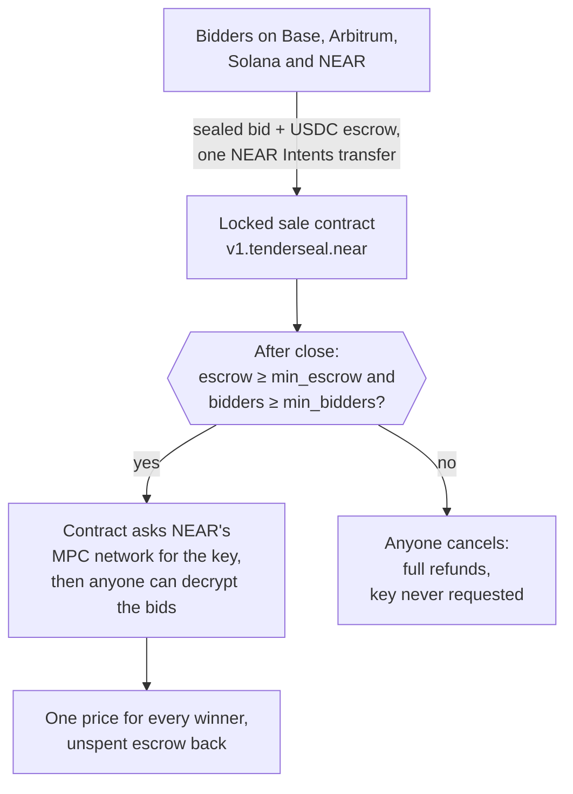
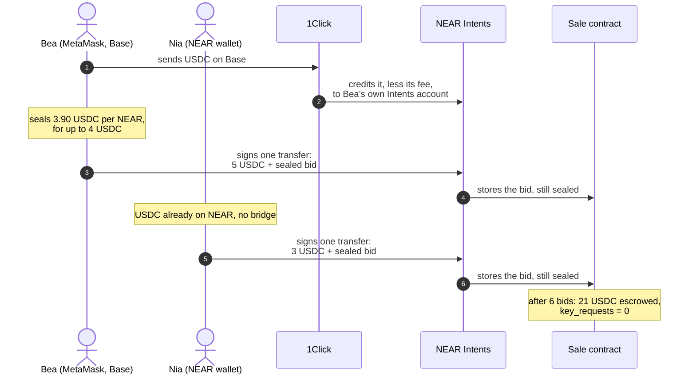
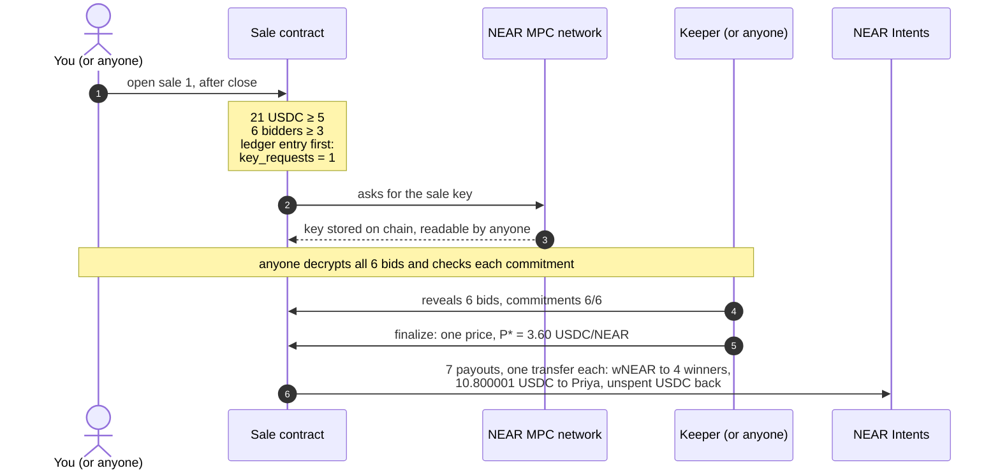
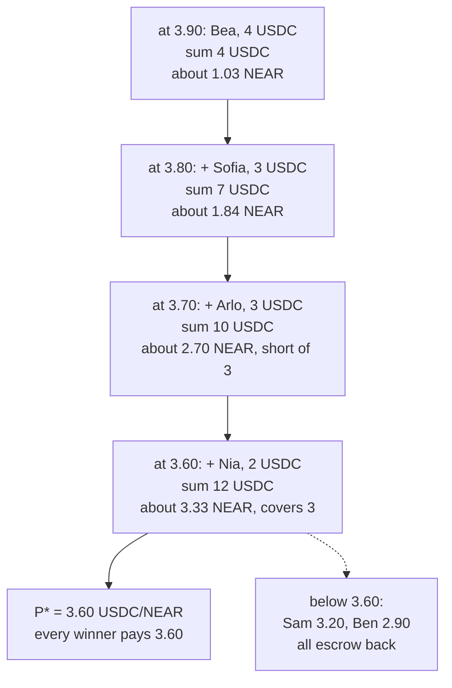
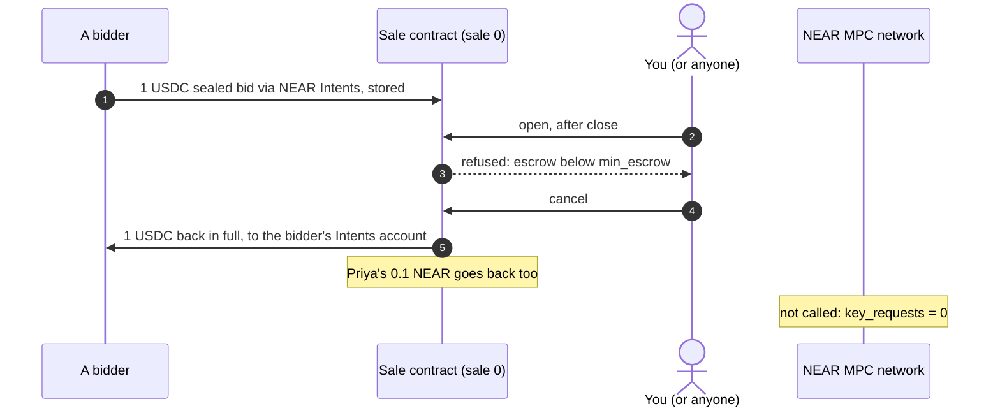
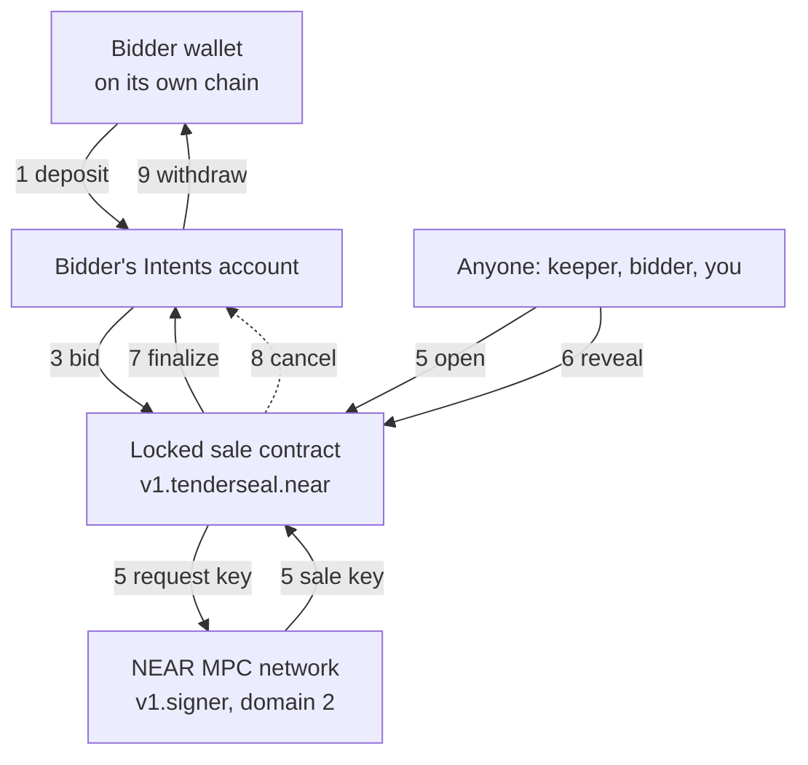
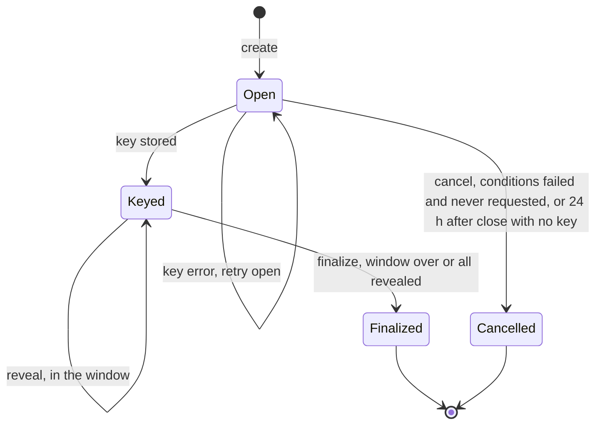
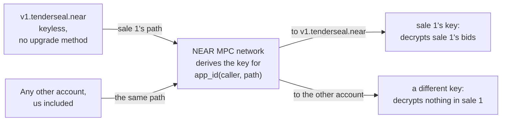

# Tender: sealed-bid token sales from any chain, opened by NEAR's MPC network

Problem: in most token sales every bid is public before close, so late bidders copy or snipe, and buyers on other chains must bridge first ([how others compare](#how-it-compares)).

Tender keeps each bid's price and size encrypted until the sale's key is released. The locked sale contract is the only account that can obtain its sales' keys from NEAR's MPC network, and it asks only when the sale's public open conditions hold.



[The story](#the-story) runs one sale down each branch.

**Status, 2026-11-11 UTC.** Runs today: steps 1-9 below ([`git clone` once the repo is public](JUDGES.md#off-chain)) and [a full testnet sale with a real MPC key](JUDGES.md#testnet). Not live yet: the mainnet contract `v1.tenderseal.near`, the [hosted app and demo video](JUDGES.md#off-chain). Every claim and its proof: [JUDGES.md](JUDGES.md).

## The story

**Priya lists a sale.** She wants to sell 3 NEAR (as wNEAR) to whoever values it most, at no less than 3.00 USDC per NEAR. She sets two public open conditions: at least 5 USDC escrowed (`min_escrow`) and at least 3 bidders (`min_bidders`). Bea, on Base, bids early; Sam, on Solana, bids later:

| | In a public sale | In Tender |
|---|---|---|
| What Sam sees before he bids | Bea's price, 3.90 | Bea's 5 USDC of escrow, no price |
| What Sam bids | off what he sees: he copies Bea, or bids just enough at the last block | his own value: 3.20 |

The names are illustrative and the numbers are the worked example in `fixtures/clearing/demo-sale-1.json`. On mainnet this sale and its twin (below) are planned, not run yet ([Demo sales](#demo-sales)); today this sale runs offline in [step 2](#try-it-free-no-wallet), and the twin's path in a sandbox test.

**Six bids from four chains.** A bid's size is the USDC it spends if it wins in full; its escrow `B` is at least that, and whatever it does not spend is refunded. Each name shares its first letter with its chain:

| Bidder | Chain and wallet | Shown in step 2's output as |
|---|---|---|
| Bea | Base, MetaMask | `base · EVM-1` |
| Sofia | Solana, Phantom | `sol · SOL-1` |
| Arlo | Arbitrum, MetaMask | `arb · EVM-2` |
| Nia | NEAR, a NEAR wallet | `near · bidder.tenderseal.near` |
| Sam | Solana, Phantom | `sol · SOL-2` |
| Ben | Base, MetaMask | `base · EVM-3` |

Bea bridges a little over 5 USDC from Base into her own NEAR Intents account. Her browser seals "3.90 USDC per NEAR, for up to 4 USDC", and she signs one transfer that carries the sealed bid and 5 USDC of escrow. Nia's USDC is already on NEAR, so she skips the bridge.



**The wall at close.** This is what Sam and everyone saw grow, one row per bid (Sam's is row 4), in step 2's output:

```text
idx origin                           escrow USDC  ct (160 B)            cm
0   base · EVM-1                            5.00  gmDodKaIonkGoBVT…  f551bf5babf2…
1   sol · SOL-1                             5.00  h6b1tvKIxqIpw8m9…  5254ce0bc204…
2   arb · EVM-2                             3.00  leQ4zxpAWI/ZlOaU…  8c0894463402…
3   near · bidder.tenderseal.near           3.00  mT0zFRaxPpRINN2Z…  4cd66e955bc6…
4   sol · SOL-2                             3.00  pf0KKJnu/ALLR9Yq…  9bfe1c6463bd…
5   base · EVM-3                            2.00  gEO3MMvnpwKpYuOS…  2b7ef1873fba…
```

Your run prints other ciphertexts and commitments: the salts are random. With `key_requests = 0`, no one has requested the key. What is public and what that rests on: [Trust and limits](#trust-and-limits).

**The sale opens.** After close anyone, even you, calls `open`: 21 USDC ≥ 5 and 6 bidders ≥ 3, so the contract records the request and asks NEAR's MPC network for the sale's key.



**Every bid opens without its bidder.** The key is public now, so Sam, you or anyone can decrypt all six bids and check each against its commitment (6/6). Our keeper reveals them, so no bidder has to come back. A bid left unrevealed when the window ends can be penalized ([rule](docs/protocol.md#clearing-and-penalty)).

**One price.** Walk down from the highest price, adding up sizes, until the bids buy all 3 NEAR. Each box converts the sum to NEAR at that box's price:



Every winner pays 3.60, Bea too, though she bid 3.90; Nia, at exactly 3.60, gets what is left.

| Bidder | Sealed bid (USDC/NEAR · size USDC) | Gets NEAR | Pays USDC | Back USDC |
|---|---|---|---|---|
| Bea | 3.90 · 4 | 1.11 | 4.00 | 1.00 |
| Sofia | 3.80 · 3 | 0.83 | 3.00 | 2.00 |
| Arlo | 3.70 · 3 | 0.83 | 3.00 | 0.00 |
| Nia | 3.60 · 2 | 0.22 | 0.800001 | 2.199999 |
| Sam | 3.20 · 3 | 0 | 0.00 | 3.00 |
| Ben | 2.90 · 2, below the 3.00 reserve | 0 | 0.00 | 2.00 |

Priya receives 10.800001 USDC, and none of her 3 NEAR comes back; 10.800001 + 10.199999 = 21 USDC, the escrow that came in. Nia's extra micro-USDC is rounding: the marginal bid's payment rounds up ([rule](docs/protocol.md#clearing-and-penalty)). NEAR is rounded here; step 2 prints 24 decimals.

**Home again.** Each of the seven is paid into their own Intents account, and Bea takes her 1.00 USDC back to Base.

**The twin sale.** Priya also runs sale 0, set up on purpose to fail its open conditions so it shows the cancel path ([how](#demo-sales)). One bidder puts in 1 USDC. After close an `open` call is refused: escrow below `min_escrow`. Anyone calls `cancel`; the bid comes back in full, so does Priya's 0.1 NEAR, and the contract never calls the MPC network ([what that means](#trust-and-limits)).



The twin's sandbox test is `s08_min_escrow_cancel_never_requested` (step 8): the same path with other numbers (1 NEAR for sale, `min_escrow` 50 USDC). The mechanics behind each beat: [How it works](#how-it-works), rows 1-9.

## Try it (free, no wallet)

Use Node 24.22.2 (`.nvmrc`); without corepack, use `npx -y pnpm@12.18.0` wherever a step says `pnpm`. Step 8 needs rustup (`contract/rust-toolchain.toml` installs Rust 1.99.1) and `cargo install --locked cargo-near@0.23.0`.

<details><summary>Node 18 or 20</summary>

Node 18 does not work, nor Node 20: the install stops with `ERR_PNPM_UNSUPPORTED_ENGINE` and names the Node it needs. With corepack on Node 18 and an empty corepack cache, the error is `Cannot find module '…/pnpm/12.18.0/bin/pnpm.cjs'` instead.

</details>

1. (network: GitHub, npm) `git clone https://github.com/kocality/tender && cd tender && corepack enable && pnpm install --filter "@tender/cli..."` - see `Scope: 4 of 7 workspace projects` and `Packages: +46`: the CLI and its libraries, no wallet SDKs.
2. (offline) `pnpm demo:local` - see `P* = 3.60 USDC/NEAR · 6/6 bids decrypted · commitments 6/6` and `done in` under a second: [the story's sale](#the-story), sealed, opened and cleared on your machine. If you run only one step, run this one.
3. (offline) `pnpm vectors` - see `4 passed (4)`: the near/mpc CKD test vectors.
4. (offline) `node contract/scripts/check-imports.mjs contract/res/tender.wasm` - see `PASS 24 imports`: none can add a key, deploy code or delete the account.
5. (network: testnet RPC) `curl -s https://rpc.testnet.near.org -H 'content-type: application/json' -d '{"jsonrpc":"2.0","id":1,"method":"query","params":{"request_type":"view_account","finality":"final","account_id":"rc2.tender-339e4b.testnet"}}'`, then the same with `"request_type":"view_access_key_list"` - see `"code_hash":"7Wr8DDsDA9XYJMw48HwDg4Y5vbWLwd38EN2A9trAezDv"` (the base58 form of step 9's sha256) and `"keys":[]`.
6. (network: testnet RPC) `pnpm verify --network testnet --contract rc2.tender-339e4b.testnet --keys` - see `key log (contract state): 0 requests` and `= 0 (match)`.
7. (network on a fresh machine) `pnpm install && pnpm -r test`, now for the whole workspace - see every package pass with the counts in the [Tests row](#build-and-test-evidence).
8. (Rust; downloads near-sandbox) `bash contract/scripts/build-wasms.sh && (cd contract && cargo test)` - see the unit, sandbox and S3a tests pass with the counts in the Tests row.
9. (Docker, about 3 min plus a one-time image pull, full git history) `git checkout 8812fce143290ba83a2597acc60e49e161a20383 && (cd contract && cargo near build reproducible-wasm && shasum -a 256 target/near/tender.wasm)` - see `60cb8293f4d48883d693cae051ed14d04cb8686669ab9477def8d110c412b2a9`, the value `contract/res/tender.wasm.sha256` holds on `main` and the hash CI printed for this commit ([JUDGES row P3](JUDGES.md#off-chain)). Build exactly this commit: the NEP-330 metadata embeds the commit, so any later commit gives a different hash. On arm64 Macs, Docker's linux/amd64 platform warning is expected.

<details><summary>Steps 10-18: on chain, once the rows they need exist</summary>

Step 10 needs testnet rows T4-T9; steps 11-15 need the mainnet rows of their sale ([Demo sales](#demo-sales)); 16-18 also need the hosted app. Until then, step 10 prints `sale 0 not found` and steps 11-15 stop with `UNKNOWN_ACCOUNT`.

| # | Do | See |
|---|---|---|
| 10 | `pnpm verify --network testnet --contract rc2.tender-339e4b.testnet --sale 0` | no `FAIL` line; `#3 code-hash` PASS against the RC2 wasm |
| 11 | `pnpm verify --keys` | every key `v1.tenderseal.near` ever requested, one line per sale |
| 12 | `pnpm seal:try --sale 2` | before `2026-11-17T12:00:00Z`: `sealed: no key has been requested for sale 2 (key_requests = 0)`; after close: `key released at block …` |
| 13 | `pnpm verify --sale 1` | no `FAIL` line; `#15 clearing-price` `P* = 3.60 USDC/NEAR` |
| 14 | `pnpm verify --sale 0` | `#23 cancelled-sealed` PASS: `Cancelled · 0 key requests · never requested (sealed unless the MPC threshold colludes)` |
| 15 | `pnpm verify --sale 3` | garbage and copied bids `Penalized`; `#17 conservation` PASS |
| 16 | hosted app `#/try`: sign with MetaMask, Phantom or a NEAR wallet | `signature valid · insufficient balance` (a view call; nothing is spent) |
| 17 | hosted app `#/`: press **Decrypt** on sale 1 (sales 1 and 0 side by side) | 6 bids decrypt in your browser and match their on-chain commitments |
| 18 | optional, costs at least 1 USDC: bid on sale 2 at hosted app `#/bid/2` before close | the bid is stored sealed |

</details>

Every check and flag: [docs/verify.md](docs/verify.md).

## How it works



Edge numbers are the table rows; rows 2 and 4 happen inside the wallet and the contract.

| # | What happens | Funds sit in |
|---|---|---|
| 1 | **Deposit.** USDC goes into the bidder's own Intents account, directly or through a 1Click deposit address. The app has no send code: you send from your own wallet. | the bidder's Intents account |
| 2 | **Seal.** In the browser or the CLI: Boneh-Franklin IBE to `pk ‖ app_id(v1.tenderseal.near, path)`, bound by a sha256 commitment. | unchanged |
| 3 | **Bid.** Signed with erc191, raw_ed25519 or nep413; carries the commitment too. | the contract's Intents account |
| 4 | **Store or refund.** `mt_on_transfer` stores the bid or [refunds it](docs/protocol.md#bids-the-contract-refunds). | the contract, or back to the bidder |
| 5 | **Open.** After close anyone can call `open`; the contract records `key_requests += 1` before the MPC call. | the contract |
| 6 | **Reveal.** Anyone can call `reveal` with the decrypted bids; our keeper does this. Bidders can also [self-reveal](docs/protocol.md#reveal). | the contract |
| 7 | **Finalize.** Integer-only clearing, paid out with `mt_batch_transfer`. An unrevealed bid can lose 10% of its escrow. | the bidders' and seller's Intents accounts ([penalty pool](docs/protocol.md#clearing-and-penalty)) |
| 8 | **Cancel.** `cancel` ([rule](docs/protocol.md#sale-states)). | back in the bidders' Intents accounts |
| 9 | **Withdraw.** Back to an origin chain through a 1Click quote; recorded: [S5](JUDGES.md#mainnet-spikes-before-the-contract). | the bidder's wallet |



Sale 1 in the story runs Open → Keyed → Finalized; its twin, sale 0, runs Open → Cancelled. The exact rules: [protocol › Sale states](docs/protocol.md#sale-states).

### NEAR technologies used

| Technology | What Tender uses | Code |
|---|---|---|
| MPC Confidential Key Derivation | `v1.signer` 3.18.0 on 2026-11-10, domain 2 (BLS12-381), `request_app_private_key` in `identity` mode ([call](docs/protocol.md#key-request)) | `contract/src/seal.rs` |
| NEAR Intents (`intents.near` 0.4.5) | `Transfer` with notification → `mt_on_transfer` (NEP-245), `simulate_intents` / `execute_intents`, `mt_batch_transfer` | `contract/src/intents.rs`, `packages/intents` |
| 1Click API | deposit addresses and withdraw quotes | `app/src/lib/oneclick.ts` |
| NEP-141 tokens | wNEAR `wrap.near`, NEAR-native USDC, JAMBO `jambo-1679.meme-cooking.near` | `sales/` |
| NEAR Connect | `@hot-labs/near-connect` 0.12.0 for NEAR wallets | `app/` |
| Contract toolchain | near-sdk 5.30.1; cargo-near reproducible build (step 9) | `contract/Cargo.toml` |

## How it compares

| | Bids hidden before close | What opens them | Who decides to open | Bid from | Source |
|---|---|---|---|---|---|
| **Tender** | yes | NEAR MPC CKD key, requested by the sale contract | the sale contract, on its open conditions | the four chains above | this repo |
| Dark Vault | yes | a drand time lock | nobody (a time, not a condition) | Zcash; SOL through NEAR Intents | [quotes](docs/compare.md#dark-vault) |
| Uniswap CCA | no | — | — | EVM chains | [quotes](docs/compare.md#uniswap-cca) |
| Echo / Sonar | no | — | — | the sale contract's chain | [quotes](docs/compare.md#echo--sonar) |
| Shutter API | yes | a time or an on-chain event | the Keyper network | Gnosis Chain | [quotes](docs/compare.md#shutter-api) |
| MACI | yes, except from the coordinator | the coordinator | the coordinator | Ethereum (voting, not a sale) | [quotes](docs/compare.md#maci) |

- **Against plain commit-reveal.** There every bidder must come back, and a bidder who sees the other reveals can withhold their own. How Tender avoids both: [the story](#the-story); the one exception: [Limits](#trust-and-limits).
- **The combination we found nowhere else:** the chain's existing MPC network as the key holder, [the only-requester rule](#trust-and-limits), an on-chain record of every key it got, and escrow plus settlement in the same contract.
- **Closest in this hackathon: Morrowseal.** It also releases a key from a NEAR contract on a condition; its key holder is an OutLayer TEE and its key stays private ([quote](docs/compare.md#morrowseal)). Tender requests with a public app key, so the released key is public; on 2026-11-10 no other `v1.signer` CKD caller's latest request did ([docs/ckd-callers.md](docs/ckd-callers.md)).

## Trust and limits

Privacy rests on NEAR's MPC threshold (11 of 16 nodes on 2026-11-10; `pnpm verify` prints the live value). We add no TEE and no committee of our own; the MPC nodes additionally run in attested TEEs. Resharing does not revoke old shares, so the threshold counts every party that holds or ever held a share of the domain-2 key.

| Sealed until the key is released | Public from the start |
|---|---|
| each bid's price, size and salt | each bid's escrow cap `B`, the bidder's Intents account and the time; total escrow and the bidder count; the origin-chain deposit transactions (the origin badge is self-declared) |

After release everything is public.



This is row 2 of the table below; the proof is the JUDGES claim row [Only `v1.tenderseal.near` can get this key](JUDGES.md#claims-and-where-to-check-them).

| You rely on | For | If it breaks |
|---|---|---|
| The MPC threshold above | bids unreadable before release | bids are read early, and nothing on chain shows it; escrow stays in the contract |
| `app_id` is derived from the calling account. `v1.tenderseal.near` is created keyless, with no upgrade method. Every sale path carries a random seed generated after the contract existed. | the only-requester rule (diagram above) | someone else could request it and read the bids early |
| Contract `open` and the reproducible build | the [open-conditions rule](JUDGES.md#claims-and-where-to-check-them) | a sale could be decrypted without meeting its conditions |
| NEAR MPC liveness | the key arrives | the sale can be cancelled (row 8 above) |
| Someone revealing within the window | bids get revealed | an unrevealed bid can pay the [row 7 penalty](#how-it-works) |
| `intents.near` signature checks | bidder identity and amounts | bids or transfers could be forged |
| 1Click and its bridges | cross-chain in and out | a stuck swap follows 1Click's own refund flow, outside the contract; fees: [recorded](docs/protocol.md#off-chain-services) |
| Our hosted JavaScript bundle | encryption in your browser | a malicious bundle could leak your price before sealing; seal locally with `pnpm seal:bid` |
| Nobody: `execute_intents` is permissionless | relaying | if our relayer refuses you, relay elsewhere ([what our relayer keeps](docs/protocol.md#off-chain-services)) |

<details><summary>Limits: what an attacker can still do, and what we do not claim (10)</summary>

Mechanics: [docs/protocol.md](docs/protocol.md).

- **Open conditions are not prices.** Anyone with capital can push a weak sale over its thresholds with below-reserve bids, get refunded, and make every bid decrypt. `min_bidders` counts distinct Intents accounts, which are cheap to create, so it gives no Sybil resistance.
- **No decrypt check on chain.** `reveal` checks the commitment, not that the ciphertext decrypts. A bidder who seals garbage under a valid commitment gets a last look: once the other bids open, they reveal from their own bid file or withhold, at the cost of the [row 7 penalty](#how-it-works); the escrow is the bond.
- **No receipt-freeness:** the salt lets a bidder prove a bid to a briber, unlike MACI.
- **"Never requested" is not "sealed for good".** It means the contract never asked for the key. The ciphertexts stay on chain, so the MPC-threshold row above still covers them, cancelled sales included, and a future compromise of NEAR's domain-2 master key would decrypt every stored bid. [A sale cancelled after a request](docs/protocol.md#key-request) is an exception.
- **MPC key change** before a sale opens: [what then](docs/protocol.md#key-request).
- **Refunded bids stay readable.** A refunded bid is not stored, but its ciphertext stays in public transaction history and decrypts if that sale's key is released. Our CLI and app [narrow this](docs/protocol.md#bids-the-contract-refunds); other signers are not covered.
- **Shill bids.** A seller's shill bids cannot be prevented, only seen after release; use the reserve price.
- **Bid limits.** At most 64 bids per sale, 1 USDC minimum each, so refunded below-reserve bids can crowd a sale out.
- **Price ceiling.** A token with 9 or fewer decimals has a [price ceiling](docs/protocol.md#clearing-and-penalty); wNEAR (24 decimals) and JAMBO (18) have none in practice.
- **Deployment.** No audit; [sale creation is restricted](docs/protocol.md#sale-states).

</details>

## Demo sales

Team-funded demo sales: there is no external seller yet. Planned on mainnet:

| Sale | What it shows | Rows |
|---|---|---|
| 0 | The story's twin. Configured by us to fail its thresholds: its `min_escrow` (1,000,000.000001 USDC) is above the contract's per-sale escrow cap, so it can never open. | [M02-M05](JUDGES.md#mainnet-tender) |
| 1 | [The story's sale](#the-story): 6 bids from 4 chains; Decrypt in the browser (step 17). | [M06-M16](JUDGES.md#mainnet-tender); testnet stand-ins: [T1, T2](JUDGES.md#testnet) (Solana and Base signatures; no Arbitrum bid is recorded yet) |
| 2 | JAMBO, a meme.cooking token, sold in a sealed round that closes inside the judging window (step 12). | [M18-M22](JUDGES.md#mainnet-tender) |
| 3 | Bad bids: garbage, copied and late (step 15). | [JUDGES.md › Attack room](JUDGES.md#attack-room) |

## Build and test evidence

| What | Result |
|---|---|
| Tests | clearing 13, intents 36, seal 37, relayer 369, app 350, cli 104 passing (pnpm; 22 more skipped); cargo 74 unit + 30 sandbox (+2 ignored) + 5 S3a (+1 ignored), with property tests; the sandbox uses a mock MPC. Clean clone at `0e5a603` (step 9's commit plus its build output), 2026-11-11 UTC |
| Wasm RC2 | the release candidate from the step 9 commit: 275,115 bytes, built twice with the same sha256 in the Docker image pinned in `contract/Cargo.toml`; report `evidence/wasm.json` |
| Entry points | integrators: `packages/seal/src/index.ts` (workspace package, not on npm); evidence file formats: `evidence/README.md` |

## Built during the hackathon (rules Q-001, Q-003)

All code in this repository was written inside the hackathon's code window, which Q-001 opens at the 2026-10-19 announcement, and there is no existing product on NEAR or any other chain (Q-002, Q-004). First commit: `17fbfc6`, 2026-11-10T00:57:39Z; later on 2026-11-10 (UTC) the history was rewritten to a single author, with commit dates kept. The IBE prototype core in `prototype/` (`ibe.mjs`, `pv.mjs`, `gen.mjs`, `t.mjs`, `vec.json`, `live.json`) is unchanged since its first commit; `s1-check.mjs`, `s2-encrypt.mjs`, `s2-decrypt.mjs`, `s7-check.mjs` and `seal-golden.mjs` were added later. Submitted state: the tag in [JUDGES row P4](JUDGES.md#off-chain).

## Libraries, prior work and AI code (Q-005)

- `@noble/curves` and `@noble/hashes` 2.4.0, `bs58` 6.0.0 (`@tender/seal`, `@tender/intents`); viem 2.57.16 and qrcode 1.5.4 (app); near-api-js 7.4.0 (relayer); `@defuse-protocol/intents-sdk` 0.95.0 (dev-only test oracle); near-workspaces 0.24.0 and proptest 1.12.0 (contract tests).
- Adapted code: drand/tlock-js IBE in `packages/seal/src/ibe.ts` and `prototype/ibe.mjs`; defdone/annon's import checker in `contract/scripts/check-imports.mjs`.
- Used unchanged: the near/mpc CKD test vectors (`fixtures/ckd_test_vectors.json`) and the near/intents wasm `contract/tests/res/defuse-0.4.5.wasm`.
- Parts of the code were written with AI coding assistants and reviewed by the team. No AI in the product, on purpose.
- Full list with licenses: `NOTICE`, `LICENSES/`.

## Other projects by team members (Q-015)

Arrow: an independent NEAR HACKATHON submission with no shared code, packages, contracts, accounts or wallets. Repository: [JUDGES row P6](JUDGES.md#off-chain).

## License

MIT (`LICENSE`).
